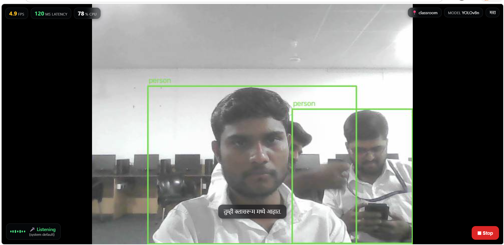
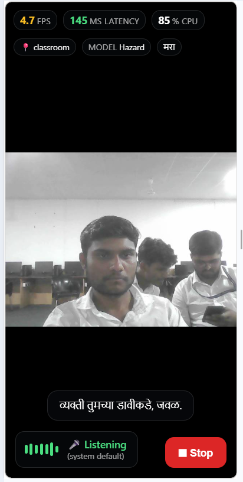
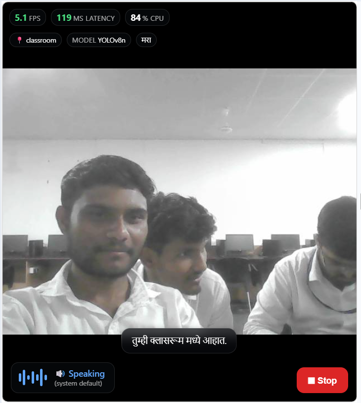

# DrishtiAI — Mitra

  <strong>A camera-and-voice assistive-vision prototype for blind and low-vision users</strong> 
  Live object detection, spoken scene guidance, and user-taught indoor routes.

  
  
  

  

<em>Prototype capture. Detection results and speed vary with the camera, scene, and computer.</em>

> **Safety notice:** Mitra is an experimental prototype. It can miss hazards or describe a scene incorrectly. It is not a certified mobility aid. Do not rely on it for traffic crossings or independent navigation; continue using established mobility aids and human support.

## The idea

DrishtiAI explores how a camera and a voice interface can help a person with low vision understand nearby objects and remember familiar indoor places. Its assistant, **Mitra**, combines object detection, scene recognition, spoken guidance, and routes taught by a user or caregiver.

The intended beneficiaries are blind and low-vision people, their families, and organizations exploring accessible technology. The current project is a working software prototype; it has not completed formal accessibility, safety, or field validation.

## Prototype screenshots

  
  &nbsp;
  

<em>Listening and speaking states from the supplied prototype captures.</em>

## What it can do

- **Live object detection:** OpenCV captures camera frames. A selected set of YOLO models runs in rotation and draws detection boxes in the video HUD.
- **Contextual spoken alerts:** The context engine groups recent detections and estimates screen zone and approximate distance from bounding-box size. These are visual heuristics, not measured distances.
- **Hazard-model hook:** An optional local hazard checkpoint can run alongside the general detectors. The current merged hazard labels use one generic class, so the model cannot reliably distinguish stairs from potholes.
- **Scene and place recognition:** CLIP compares the camera view with built-in scene prompts and reference photos in the places folder.
- **User-taught places and routes:** Mitra can save reference views and text directions between named places. The saved map and profile are stored locally under the data folder.
- **Voice commands and speech:** Commands are handled in English, Hindi, and Marathi. The UI also offers a text command field, language selection, microphone selection, echo protection, and speech controls.
- **Live HUD:** The local video view can show FPS, latency, CPU use, the active model, recognized place, voice state, captions, and detection boxes.

### Voice command examples

Try phrases such as:

- “Where am I?” or “What is in front?”
- “How many people?” or “Is it safe?”
- “Start teaching,” then “Remember this place”
- “Take me to the hall,” after teaching a route
- “Next,” “Repeat,” “Stop guiding,” “Stop talking,” or “Help”

Recognition depends on microphone quality, language, background noise, and network availability. Use a headset if speaker audio feeds back into the microphone.

## How the pieces fit

~~~mermaid
flowchart LR
    Cam[Camera] --> CV[OpenCV frame capture]
    CV --> YOLO[Rotating YOLO detectors]
    YOLO --> Ctx[Context and alert filtering]
    Ctx --> TTS[Spoken feedback]
    Cam --> CLIP[CLIP scene and place matching]
    Photos[Reference photos] --> CLIP
    CLIP --> Routes[Saved places and route guidance]
    Map[User-taught map] --> Routes
    Mic[Microphone] --> STT[SpeechRecognition]
    STT --> Dialog[English, Hindi, Marathi commands]
    Dialog --> Routes
    Dialog --> TTS
    CV --> Stream[Local MJPEG video and HUD]
    Stream --> UI[Streamlit controls]
~~~

## Requirements

- Python **3.13**; the verified setup is Windows with Python 3.13.8. Linux or macOS may need platform-specific PyAudio/PyTorch installation steps.
- A camera accessible to OpenCV, a microphone, and a speaker or headset.
- Windows, Linux, or macOS with the pinned packages in requirements.txt.
- Internet for Google speech recognition, Edge TTS, and the first CLIP model download. YOLO checkpoint files are included in the project.

The current implementation uses the camera and microphone attached to the computer running Python. The browser displays the local Streamlit controls and video stream; it does not pass a remote visitor’s camera or microphone into the Python process.

## Run the browser app

In PowerShell, from the project directory:

~~~powershell
py -3.13 -m venv .venv
.\.venv\Scripts\Activate.ps1
python -m pip install --upgrade pip
python -m pip install -r requirements.txt

$env:BLIND_PROFILE = "light"
python -m streamlit run app.py
~~~

Open **http://localhost:8501** on the same computer. Press **Start**, open **Audio, teaching places, me & commands**, select a microphone under **Audio & Listening**, and check the listener status. Use **Test speaker** to confirm audio output.

If venv activation is blocked, run the install and launch commands with .\.venv\Scripts\python.exe instead of python.

## Run without Streamlit

The standalone runner starts the camera pipeline and local HUD:

~~~powershell
python main.py --profile light --lang en
~~~

The terminal prints the HUD address, usually **http://localhost:8765**. You can select a camera source with --camera, for example --camera 1 or a camera stream URL. Run python main.py --help to see all options.

## Performance profiles

Set BLIND_PROFILE to choose the configured workload. The inference caps below are limits from config.py, not promised measured FPS.

| Profile | Detector models | Input size | Inference cap |
| --- | ---: | ---: | ---: |
| light | 3 | 256 px | 5 FPS |
| balanced (default) | 5 | 320 px | 8 FPS |
| full | 7 | 320 px | 10 FPS |

The optional hazard checkpoint is scheduled separately. Actual speed depends on the device, model loading, camera, and whether scene recognition is enabled.

Other useful settings:

| Setting | Purpose |
| --- | --- |
| BLIND_CAMERA | Camera index or camera/RTSP URL; defaults to camera 0. |
| BLIND_DEVICE | Inference device; defaults to CPU. |
| BLIND_PORT | Local HUD port; defaults to 8765. |
| BLIND_STREAM_LAN | Set to 1 to bind the HUD to the LAN. This stream has no login; keep it off unless you understand and trust the network. |

## Places and hazard training

CLIP can use built-in scene references in the places folder. The app’s **Teach places** controls capture a user’s own place references and save the route map under data. These personal files are intentionally excluded from Git.

Hazard training is not ready to run from this repository alone. The training script expects a labeled dataset at datasets/hazards/images/{train,val} and datasets/hazards/labels/{train,val}. Raw image and label folders are excluded by .gitignore. Before training, review and correctly label the dataset; the current YAML intentionally maps all class-0 examples to the generic class hazard.

~~~powershell
python train_hazards.py
~~~

Training uses yolo11n.pt as its base checkpoint and writes the resulting model to hazards.pt. A successful training run does not by itself establish detection accuracy or safety.

## Checks and local benchmarking

Run the project’s mock-based checks:

~~~powershell
python tests/test_all.py
python tests/test_app.py
python tests/test_stream.py
~~~

These checks exercise application and stream behavior with test fixtures. They do not validate real-world detection accuracy, microphone quality, speech recognition, or navigation safety.

To compare the available detector models on your own computer, run python benchmark.py. Benchmark output is hardware-specific and should not be presented as a general performance guarantee.

## Privacy and deployment

- Voice input uses Google Speech Recognition, which receives audio for transcription. When Edge TTS is used, narration text is sent to Microsoft’s service. An English local TTS fallback is available when online synthesis fails.
- CLIP model files may download from Hugging Face on first use.
- Personal profile notes, captured route photos, and learned maps are stored in data; this directory is ignored by Git. Check before sharing screenshots or logs for personal information.
- The stream binds to loopback by default. The optional LAN mode has no authentication.
- GitHub is suitable for sharing the source and prototype images. A public hosted app is not currently a working deployment target: the Python process needs the camera and microphone on its own host, and the video HUD uses a local stream.
- This checkout has no root-level project license. Add an appropriate license before inviting reuse, and check the terms for bundled third-party model weights before redistributing them.

## Seva First Innovation Challenge

This project can be presented as an **assistive-technology prototype for accessibility and inclusion**. For a credible submission, describe the community need, show the working prototype, and add evidence from user feedback and testing, a cost estimate, and a realistic deployment plan. Those validation results are not yet included in this repository.

For the Maharashtra Zone, the official guidelines call for a single PowerPoint submission prepared with the challenge template. This README is project documentation, not a replacement for the official application. Confirm eligibility, sector, deadline, and format for the zone you are applying through.

Check the portal and submission category for your region:

- [Seva First Innovation Challenge — national/South Zone portal](https://sevafirst.mic.gov.in/)
- [Seva First Innovation Challenge — Maharashtra Zone portal and guidelines/template](https://www.sevainnovationchallenge.in/guidelines.html)

## Project layout

| File or folder | Purpose |
| --- | --- |
| app.py | Streamlit controls and browser interface. |
| main.py | Standalone runner and local HUD. |
| pipeline.py | Camera, models, voice, scene recognition, and assistant orchestration. |
| stream.py | Local MJPEG server, video HUD, and stream controls. |
| assistant.py, voice.py, speaker.py | Command handling, speech recognition, and speech output. |
| yolo_models.py, context_engine.py | Detector loading and spoken alert decisions. |
| scene.py, places.py | CLIP scene/place recognition and built-in place references. |
| navmap.py, store.py | User-taught maps, routes, and local profile storage. |
| config.py, requirements.txt | Runtime profiles, environment settings, and pinned dependencies. |
| benchmark.py, evaluate_places.py | Local detector benchmark and place-recognition evaluation scripts. |
| collect_places.py | Capture reference images for a built-in place category. |
| train_hazards.py | Train and install the optional hazard checkpoint. |
| datasets/hazards/ | Hazard dataset configuration; raw training data is not included. |
| *.pt | Bundled YOLO checkpoint files. Check upstream terms before redistribution. |
| tests/ | Mock-based application and streaming checks. |
| assets/ | Prototype screenshots used in this README. |

---

**Project status:** Demonstration prototype. The screenshots show the current interface; they are not an accuracy benchmark or a safety certification.
